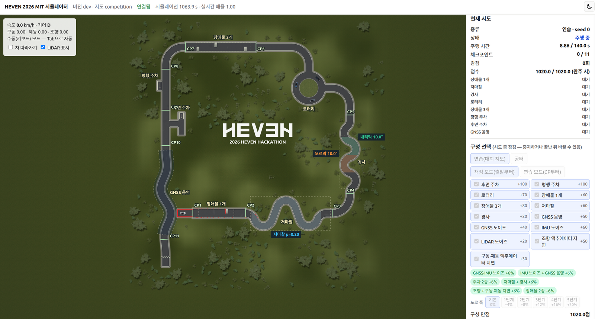
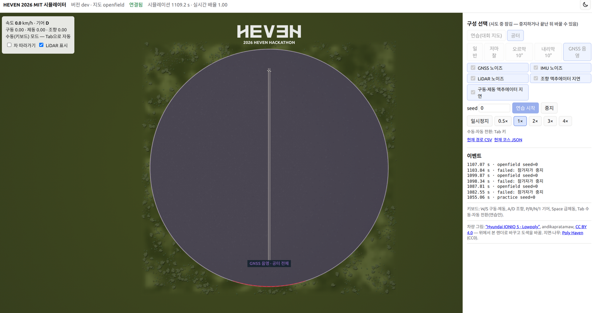
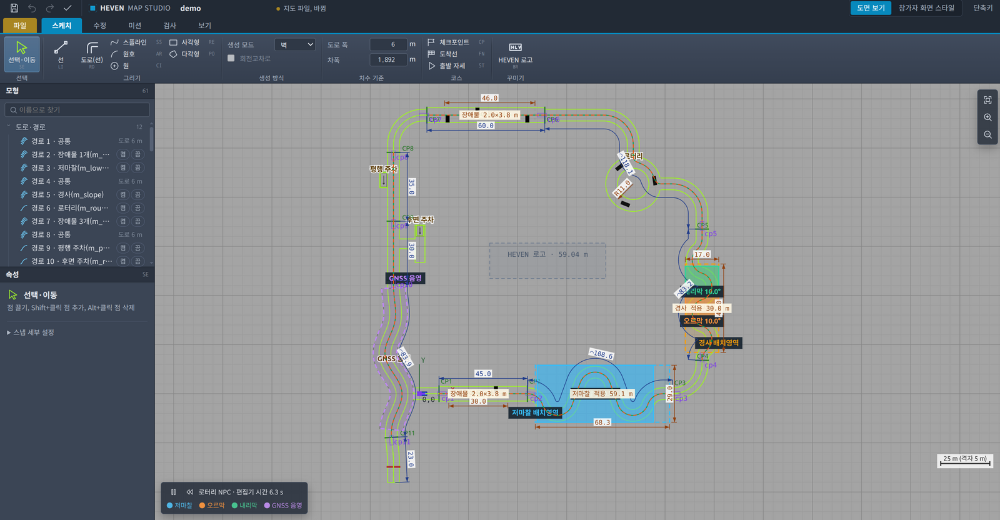
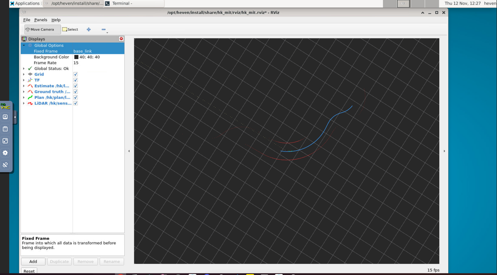
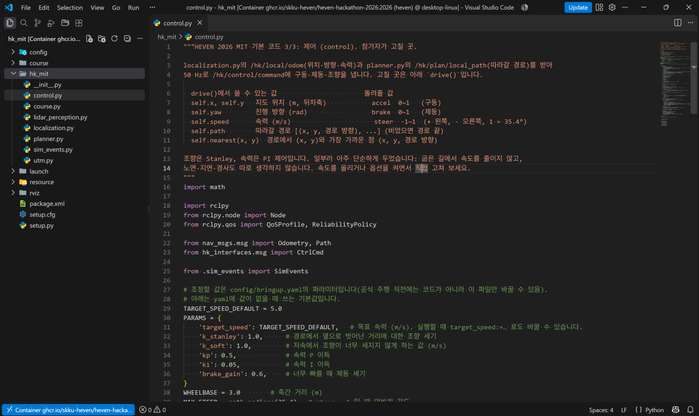
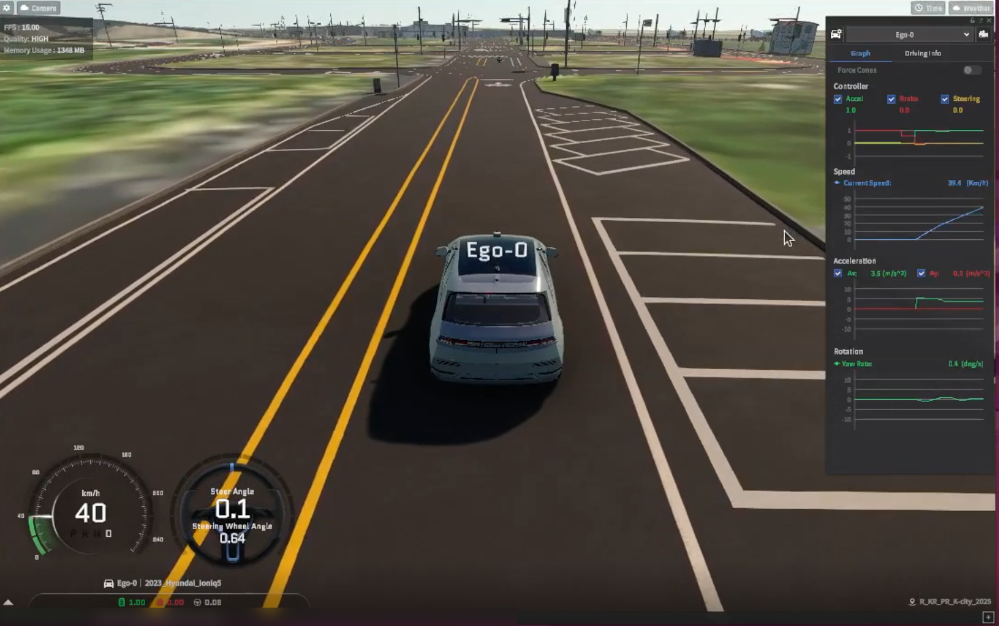
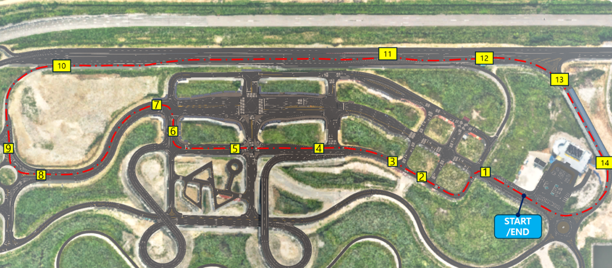

# 2026 성균관대 자율주행 해커톤 — 참가자 실행 환경

<p align="center">
  
</p>

자율주행 소프트웨어를 하룻밤 동안 직접 만들어 보는 해커톤의 참가자용 저장소입니다. 이 저장소의 실행 스크립트 하나로 시뮬레이터 Docker 이미지를 받아 켜고, ROS 2 기본 코드를 작업 폴더에 풀어 바로 개발을 시작할 수 있습니다.

| 종목 | 어디서 | 기본 코드 | 공식 주행 | 비중 |
|---|---|---|---|---|
| **MIT 시뮬레이터** | 각자 노트북 (Docker) | `hk_mit` | 2회, 제한 150초 | 60% |
| **MORAI** (K-City) | 운영진 PC | `hk_morai` | 1회, 제한 10분 | 30% |
| **발표** | 발표장 | – | 팀당 5분 | 10% |

- 시뮬레이터 이미지: `ghcr.io/skku-heven/heven-hackathon-2026:2026` (Ubuntu 22.04 + ROS 2 Humble, amd64·arm64)
- 일정: 2026. 11. 13 (금) 17:00 – 11. 14 (토) 10:00
- 자세한 안내: [대회 Notion 페이지](https://app.notion.com/p/2026-416a48b57a16808e8bc0c0f4e688aed3)

---

## 목차

1. [빠른 시작](#1-빠른-시작)
2. [자주 쓰는 명령](#2-자주-쓰는-명령)
3. [작업 폴더](#3-작업-폴더)
4. [시스템 구조](#4-시스템-구조)
5. [MIT 시뮬레이터](#5-mit-시뮬레이터)
6. [개발 도구](#6-개발-도구)
7. [MORAI](#7-morai)
8. [업데이트](#8-업데이트)

---

## 1. 빠른 시작

### 준비물

- **Docker** — Windows·macOS는 [Docker Desktop](https://docs.docker.com/desktop/), Ubuntu는 [Docker Engine](https://docs.docker.com/engine/install/ubuntu/). macOS는 칩에 맞는 파일(Apple 칩 / Intel)을 받고, Docker Desktop → Resources에서 CPU 4개·메모리 8 GB 이상을 줍니다.
- **Git** — `git --version`으로 확인합니다.
- **터미널** — macOS·Ubuntu는 기본 터미널, Windows는 **Windows PowerShell**(CMD 아님).

Windows는 WSL이 필요합니다. PowerShell을 관리자 권한으로 열고 한 번 실행합니다.

```powershell
wsl --install
```

Ubuntu는 Docker 설치 뒤 한 번 실행하고 다시 로그인합니다(이후 `sudo` 없이 실행).

```bash
sudo usermod -aG docker $USER
```

`docker info`를 실행해 **Server:** 정보까지 오류 없이 나오면 준비가 끝난 것입니다.

### 실행

처음 한 번은 이미지(약 3.5 GB)를 내려받습니다. 끝나면 브라우저에 시뮬레이터 화면이 열리고 **연결됨**이 표시됩니다.

**macOS · Ubuntu**

```bash
cd ~ && git clone https://github.com/skku-heven/heven-hackathon-2026.git
cd ~/heven-hackathon-2026 && ./run.sh
```

**Windows PowerShell**

```powershell
cd $HOME; git clone https://github.com/skku-heven/heven-hackathon-2026.git
cd $HOME\heven-hackathon-2026; .\run.ps1
```

> 화면은 스크립트가 연 주소(일회용 토큰 포함)로만 열립니다. 창을 닫았으면 같은 명령을 다시 실행하세요. 주소창에 `localhost:8080`만 치면 열리지 않습니다.

<details>
<summary><b>안 될 때</b></summary>

- Windows에서 "스크립트를 실행할 수 없습니다":
  ```powershell
  powershell -NoProfile -ExecutionPolicy Bypass -File .\run.ps1
  ```
- macOS·Ubuntu에서 `permission denied`:
  ```bash
  chmod +x run.sh && ./run.sh
  ```
- `Cannot connect to the Docker daemon` / `error during connect`: Docker가 꺼져 있습니다. Docker Desktop을 켜고 준비가 끝난 뒤 다시 실행합니다.

</details>

---

## 2. 자주 쓰는 명령

Windows는 `./run.sh` 대신 `.\run.ps1`을 씁니다.

| 명령 | 하는 일 |
|---|---|
| `./run.sh` | 시뮬레이터를 켜고 브라우저 화면을 엽니다 |
| `./run.sh shell` | 컨테이너 터미널(ROS 2 Humble). 빌드·실행은 여기서 합니다. 여러 개 열어도 같은 컨테이너입니다 |
| `./run.sh desktop` | 브라우저 데스크톱 [localhost:6080](http://localhost:6080) (RViz·rqt·터미널) |
| `./run.sh update` | 새 이미지 받기 (작업 폴더는 그대로) |
| `./run.sh stop` | 끄기 (작업 폴더는 그대로) |

컨테이너 터미널은 일반 사용자라 `apt`·`sudo`가 없습니다. Python 패키지는 `pip3 install --user <패키지>`로 설치하면 작업 폴더에 남습니다. scipy·Eigen·tf_transformations는 들어 있습니다.

---

## 3. 작업 폴더

처음 실행하면 홈에 `heven_hackathon_2026_ws`가 생기고 기본 코드가 들어갑니다. 노트북 폴더를 컨테이너에 그대로 연결한 것이라 어느 쪽에서 고쳐도 같은 파일이고, 컨테이너를 지워도 남습니다.

```txt
~/heven_hackathon_2026_ws/
├── mit_ws/                      # MIT 개발 (컨테이너 /mit_ws)
│   └── src/hk_mit/
│       ├── hk_mit/              # localization.py · planner.py · control.py · lidar_perception.py ✏️
│       ├── course/              # 전역 경로 route.csv · 코스 course.json
│       ├── config/              # bringup.yaml(파라미터) · sensor_mounts.yaml(센서 위치)
│       └── launch/bringup.launch.py
├── morai_ws/                    # MORAI 개발 (컨테이너 /morai_ws, 노트북에서는 빌드 확인만)
│   └── src/hk_morai/
│       ├── hk_morai/            # localization · planner · control · lidar_perception · camera_perception ✏️
│       ├── course/              # morai_global_path.csv · morai_course.json
│       ├── config/              # bringup.yaml · sensor_mounts.yaml
│       └── launch/bringup.launch.py
└── data/                        # 결과 기록 (컨테이너 /data)
```

| 구분 | macOS · Ubuntu | Windows |
|---|---|---|
| 저장소 (실행 스크립트) | `~/heven-hackathon-2026` | `C:\Users\<사용자>\heven-hackathon-2026` |
| 작업 폴더 (내 코드·결과) | `~/heven_hackathon_2026_ws` | `C:\Users\<사용자>\heven_hackathon_2026_ws` |

---

## 4. 시스템 구조

```txt
 내 노트북 (호스트)                              Docker 컨테이너 (Ubuntu 22.04 + ROS 2 Humble)
┌──────────────────────────┐               ┌──────────────────────────────────────────────────┐
│ 브라우저 localhost:8080 ◀─┼─ HTTP·WebSocket ─┼─ 웹 서버(hk_web) ◀─ IPC ─ 시뮬레이터(hk_sim)     │
│                          │               │                                  │ ROS 2 토픽     │
│ 브라우저 localhost:6080 ◀─┼─ noVNC ─────────┼─ 데스크톱(Xfce, RViz)           ▼                │
│                          │               │                        내 노드(hk_mit 등)         │
│ 터미널: ./run.sh shell ──┼─ docker exec ───┼─▶ bash (ROS 2 환경)                              │
│                          │               │                                                  │
│ heven_hackathon_2026_ws ◀┼─ 폴더 연결 ─────┼─▶ /mit_ws · /morai_ws · /data                    │
└──────────────────────────┘               └──────────────────────────────────────────────────┘
```

- 시뮬레이터와 참가자 코드는 컨테이너 안에서 **ROS 2 토픽**으로만 주고받습니다. 그래서 빌드·실행·`ros2 topic`은 컨테이너 터미널에서 합니다.
- 브라우저 화면(8080)과 데스크톱(6080)은 내 노트북에서만 열립니다.

---

## 5. MIT 시뮬레이터

2D 차량 동역학(IONIQ 5), GNSS·IMU·바퀴 속도·2D LiDAR 센서, 미션(주차·로터리·장애물·노면)을 갖춘 대회 전용 시뮬레이터입니다. 코스는 체크포인트(CP) 11개로 나뉘어 있어, 원하는 CP부터 구간별로 연습할 수 있습니다.

### 5.1. 빌드하고 달리기

① 시뮬레이터를 켭니다 → ② 새 터미널에서 컨테이너에 들어갑니다.

```bash
./run.sh shell
```

③ 컨테이너 안에서 빌드하고 기본 코드를 실행합니다. 실행한 터미널은 닫지 마세요.

```bash
cd /mit_ws && colcon build && source install/setup.bash
ros2 launch hk_mit bringup.launch.py          # perception:=true 로 LiDAR 노드도, rviz:=true 로 RViz도
```

④ 브라우저에서 **연습(대회 지도) → 채점 모드(출발부터) → 옵션 선택 → 연습 시작**을 누릅니다. `/sim/events`로 START가 오면 차가 출발합니다. 기본 코드로 옵션을 모두 끄면 약 133초에 완주합니다.

⑤ 코드를 고쳤으면 `Ctrl+C` → `colcon build` → 다시 실행합니다. 노드를 먼저 띄운 뒤 연습을 시작하세요.

- **채점 모드**는 출발부터 달려 점수가 나오고, **연습 모드(CP부터)**는 고른 체크포인트부터 달리며 채점하지 않습니다.
- 화면이 수동 모드면 지도를 클릭하고 `Tab`으로 자동 모드로 바꿉니다. 수동 모드에서는 W/S(구동·제동), A/D(조향)로 직접 몰 수 있습니다.

### 5.2. 기본 코드

노드 셋이 토픽으로 이어집니다. ✏️ 표시가 고칠 곳이고, 노드를 통째로 자기 코드(C++ 포함)로 바꿔도 됩니다.

```txt
센서 ─▶ localization ─/hk/local/odom─▶ planner ─/hk/plan/local_path─▶ control ─▶ /hk/control/command
```

| 파일 | 하는 일 |
|---|---|
| ✏️ `localization.py` | 위치 추정 → `/hk/local/odom`. GNSS 위치 그대로, IMU 각속도 적분, 바퀴 속도 |
| ✏️ `planner.py` | 전역 경로(`course/route.csv`)에서 차 앞 30 m → `/hk/plan/local_path` |
| ✏️ `control.py` | Stanley 조향 + PI 속도(5 m/s) → `/hk/control/command`. 목표 속력·이득은 `config/bringup.yaml` |
| ✏️ `lidar_perception.py` | LiDAR 받기만 함 (`perception:=true`일 때 실행) |
| `course.py` · `sim_events.py` · `utm.py` | 코스 파일, 시작·복귀 이벤트, 좌표 변환 |

기본 코드는 일부러 단순합니다. 곡선 감속, 노면·지연 보정, GNSS 필터, 음영 구간 추측 항법, 장애물 회피, 주차는 들어 있지 않습니다.

- 차량: IONIQ 5 (길이 4.635 m, 폭 1.892 m, 축거 3.0 m, 최대 조향 35.4°). 기준점 `base_link`는 후륜 축 중심을 지면에 내린 점입니다.
- `course/route.csv`(x, y, 0.5 m 간격)와 `course/course.json`(출발·체크포인트 자세, 지도 원점, 미션 구역)은 패키지 안에 있고, 시도마다 고른 구성의 경로가 `/data/current/`에도 저장됩니다.

### 5.3. 토픽

| 토픽 | 메시지 | 내용 |
|---|---|---|
| `/clock` | rosgraph_msgs/Clock | 시뮬레이션 시각 (`use_sim_time=true`) |
| `/hk/sensors/gps/fix` | sensor_msgs/NavSatFix | GNSS 20 Hz. 음영 구간에서는 나오지 않음 |
| `/hk/sensors/imu/data` | sensor_msgs/Imu | IMU 100 Hz. 가속도·각속도만 (자세 없음) |
| `/hk/sensors/wheel_encoder/speed` | geometry_msgs/TwistStamped | 바퀴 속도 50 Hz, 부호 있음, 슬립 반영 |
| `/hk/sensors/lidar/scan` | sensor_msgs/LaserScan | 10 Hz · 360° · 720빔 · 0.5–100 m |
| `/sim/events` | hk_interfaces/SimEvent | START · RESPAWN · END · WARN |
| `/hk/control/command` | hk_interfaces/CtrlCmd | 참가자 → 시뮬레이터: 구동 · 제동 · 조향 · 기어 |
| `/dev/ground_truth` | nav_msgs/Odometry | 정답 위치·자세·속도. 연습·공터에서 추정 검증용 |

공통 토픽 `/hk/local/odom`(50 Hz)·`/hk/plan/local_path`(20 Hz)와 TF `map → base_link → rear_axle_link → gps_link · imu_link · lidar_link`는 MIT·MORAI가 같습니다. 센서는 SensorDataQoS(best effort)로 구독합니다.

### 5.4. 구성 옵션과 점수

참가자가 직접 난이도를 고릅니다. 켠 항목만큼 만점이 커지고, 빨리 완주할수록 최대 2배까지 늘어납니다.

**구성 만점** = (10 + 켠 항목 점수 합) × (1 + 세트 보너스 % + 도로 폭 단계 × 4%)

| 미션 | 점수 | 센서·액추에이터 | 점수 |
|---|---|---|---|
| 평행 주차 | 110 | GNSS 음영 | 50 |
| 후면 주차 | 110 | GNSS 노이즈 | 40 |
| 로터리 (NPC 3대) | 70 | IMU 노이즈 | 60 |
| 장애물 1개 | 60 | LiDAR 노이즈 | 20 |
| 장애물 3개 | 80 | 조향 지연 (250 ms) | 50 |
| 저마찰 (μ 0.2) | 60 | 구동·제동 지연 (75 ms) | 30 |
| 경사 (±10°) | 20 | | |

- **세트 보너스** +6%씩: GNSS·IMU 노이즈 / IMU 노이즈 + GNSS 음영 / 주차 2종 / 저마찰 + 경사 / 지연 2종 / 장애물 2종
- **도로 폭 0–5단계**: 통로 4.39 m → 2.99 m, 1단계부터 +4%씩. 모두 켜고 5단계면 1201.2점
- **완주 점수** = 구성 만점 × (1 − 0.2 × 감점 수) × (1 + (150 − 완주 시간) / 150)
- 벽·장애물·NPC에 닿으면 감점 후 마지막 CP로 복귀하고, 5번째면 실패입니다.
- 장애물·저마찰·경사 위치, 주차 칸 위치(±3 m), NPC 속도, 노이즈 크기와 지연은 시도마다 **seed**로 바뀝니다. 범위는 `course.json`에 있습니다.

---

## 6. 개발 도구

### 공터



지름이 넉넉한 원형 공터입니다. 일반·저마찰·오르막·내리막·GNSS 음영 노면을 골라 차량 응답, 센서 잡음, 지연을 직접 계측하고 파라미터를 찾을 수 있습니다.

### 맵 에디터



대회 지도를 만든 에디터(HEVEN MAP STUDIO)입니다. 도로·경로, 체크포인트, 미션 구역과 치수를 한 화면에서 볼 수 있습니다.

### RViz (브라우저 데스크톱)



`./run.sh desktop`으로 [localhost:6080](http://localhost:6080)을 열고, 그 안의 터미널에서 실행합니다.

```bash
# 기본 코드가 이미 돌고 있으면 RViz만
rviz2 -d /mit_ws/install/hk_mit/share/hk_mit/rviz/hk_mit.rviz --ros-args -p use_sim_time:=true
# 아니면 기본 코드와 함께
cd /mit_ws && source install/setup.bash && ros2 launch hk_mit bringup.launch.py rviz:=true
```

추정 위치, 정답 위치(연습·공터만), 계획 경로, LiDAR가 겹쳐 보여 내 위치 추정이 얼마나 맞는지 바로 확인할 수 있습니다.

### VS Code (Dev Containers)



시뮬레이터를 켠 상태에서 **Dev Containers** 확장 → 왼쪽 아래 `><` → **Attach to Running Container…** → `/heven` → 폴더 `/mit_ws`를 열면, 편집기와 터미널(`Ctrl+J`)이 모두 컨테이너 안에서 돕니다. 이 터미널에서 바로 빌드·실행할 수 있고, Codex·Claude Code 같은 AI 코딩 도구도 컨테이너 환경 그대로 쓸 수 있습니다.

```bash
curl -fsSL https://chatgpt.com/codex/install.sh | sh          # 컨테이너 안에 Codex 설치
echo 'export PATH="$HOME/.local/bin:$PATH"' >> ~/.bashrc && source ~/.bashrc
```

---

## 7. MORAI



MORAI 종목은 실제 시험장을 옮긴 **K-City** 지도에서 IONIQ 5로 전역 경로 한 바퀴(약 2.2 km)를 달립니다. MORAI는 운영진 PC에서만 돌기 때문에, 노트북에서는 `morai_ws`를 빌드 확인만 하고 자기 차례에 `morai_ws/src`를 USB로 가져갑니다.

### 코스



START/END에서 출발해 CP1 → CP14를 순서대로(각 반경 3 m) 지나 도착선으로 들어옵니다.

| 구간 | 제한속도 |
|---|---|
| 기본 | 60 km/h |
| CP4 → CP5 (어린이 보호구역) | 30 km/h |
| CP10 → CP12 (고속도로) | 제한 없음 |

CP 좌표, 출발점, 도착선, 제한속도 구간은 `course/morai_course.json`에, 전역 경로는 `course/morai_global_path.csv`에 있습니다.

### 진행

```bash
# 운영진 PC의 팀 셸에서
colcon build && source install/setup.bash
ros2 launch hk_morai bringup.launch.py        # perception:=true 로 LiDAR·카메라 노드도
```

노드를 띄우면 측정기에서 시도를 준비하고 시작합니다. `/sim/events`로 START가 오면 출발하고, 시작 후 20초 안에 움직여야 합니다. 차선 침범·과속·복귀는 각각 15초 패널티이고, GPS·IMU 노이즈를 끄면 기록에 배율(1.1–1.5)이 붙습니다.

### 기본 코드와 센서

| 파일 | 하는 일 · 고칠 거리 |
|---|---|
| ✏️ `localization.py` | GPS·IMU → `/hk/local/odom`. GPS 노이즈에 대비한 필터·보간 |
| ✏️ `planner.py` | `morai_global_path.csv`에서 앞 30 m. 제한속도·곡률을 본 속도 계획 |
| ✏️ `control.py` | Stanley + PI (기본 3 m/s). 목표 속력 올리기, 곡선 감속 |
| ✏️ `lidar_perception.py` · `camera_perception.py` | VLP-16 점군, 카메라 4대 (전방·좌·우·신호등) |

| 토픽 | 메시지 | 내용 |
|---|---|---|
| `/hk/sensors/gps/fix` | sensor_msgs/NavSatFix | GPS 20 Hz |
| `/hk/sensors/imu/data` | sensor_msgs/Imu | IMU 50 Hz (자세 포함) |
| `/hk/sensors/lidar/points` | sensor_msgs/PointCloud2 | VLP-16 3D LiDAR 10 Hz |
| `/hk/sensors/camera/{front,left,right,traffic_light}/compressed` | sensor_msgs/CompressedImage | RGB 카메라 JPEG 20 Hz |
| `/sim/events` · `/hk/control/command` | | MIT와 같음 |

MORAI에는 `/clock`이 없어 `use_sim_time=false`로 실행합니다. 공식 주행 직전에는 코드는 못 바꾸고 `config/bringup.yaml`과 실행 인자만 바꿀 수 있으니, 현장에서 조정할 값은 미리 파라미터로 빼 두세요.

---

## 8. 업데이트

시뮬레이터 이미지가 갱신되면 저장소 폴더에서 받습니다. 작업 폴더의 코드는 그대로 남습니다.

```bash
cd ~/heven-hackathon-2026 && git pull && ./run.sh update
```

```powershell
cd $HOME\heven-hackathon-2026; git pull; .\run.ps1 update
```

업데이트 뒤에는 컨테이너 터미널을 새로 열고 `colcon build`를 다시 합니다.

---

<sub>시뮬레이터 이미지는 개발 저장소에서 검증한 뒤 GitHub 패키지로 배포합니다. `run.sh`·`run.ps1`과 기본 코드(`hk_mit`, `hk_morai`)는 이미지와 함께 배포되며, 기본 코드는 처음 실행할 때 작업 폴더로 복사됩니다. 제3자 구성 요소의 라이선스는 [THIRD_PARTY_NOTICES.md](THIRD_PARTY_NOTICES.md)에 있습니다.</sub>
